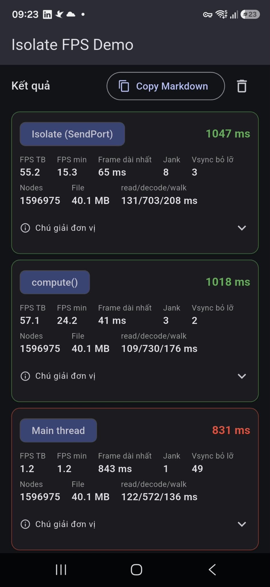
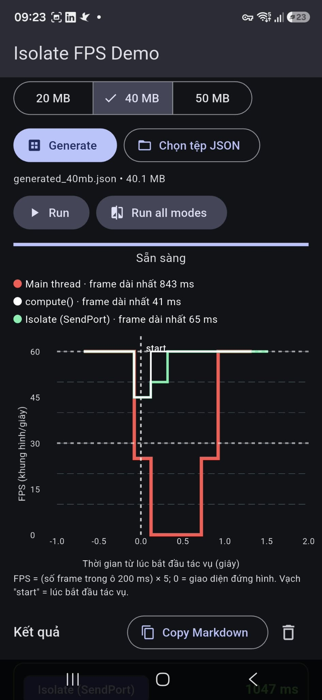
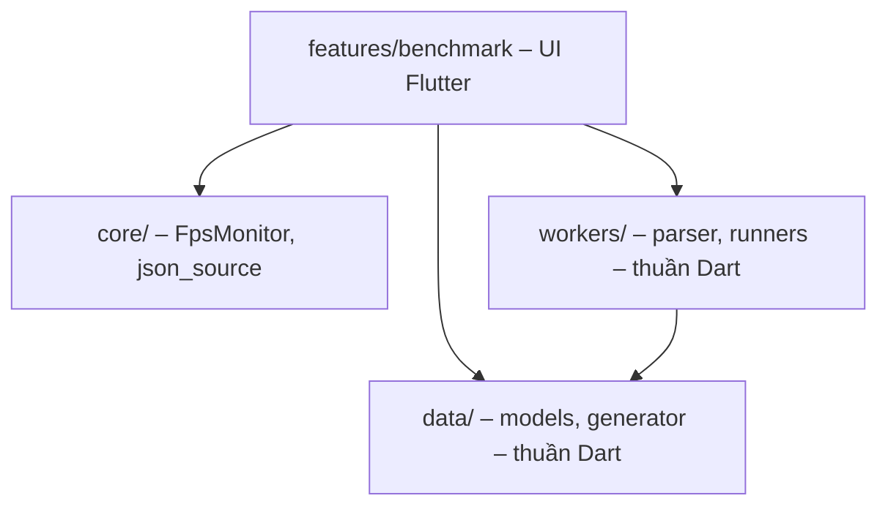

# Isolate FPS Demo – Đa luồng với Isolates (Flutter/Android)

> **English summary.** A Flutter demo app for *"Multithreading with Isolates
> – Non-blocking UI"*. It measures real UI FPS while parsing **any JSON
> file** (self-generated 20/40/50 MB or user-picked) in three ways: on the
> **main thread**, via **`compute()`**, and via **`Isolate.spawn` +
> `SendPort`/`ReceivePort`** with live progress. The chart combines the
> latest run of all three modes on one time axis (task start = 0 s): Main
> in red drops to 0 FPS while frozen, compute (white) and Isolate (green)
> stay near 60. Results export to Markdown. Android-only; `flutter analyze`
> clean; unit tests included. All published numbers must come from real
> device runs – no simulated data.

Ứng dụng demo cho **Chủ đề 03 – Đa luồng với Isolates**: đo FPS giao diện
thực tế khi parse tệp JSON trên **Main thread**, **`compute()`** và
**`Isolate.spawn` + SendPort/ReceivePort**, chứng minh Isolate giữ UI mượt
trong khi tác vụ nặng chạy nền.

## 1. Chạy thử nhanh

1. Tải **[app-release.apk](app-release.apk)** ở ngay gốc repo (bên cạnh
   `README.md`).
2. Cài vào điện thoại Android (cho phép cài app từ nguồn ngoài khi được hỏi).
3. Mở app → **Generate** (mặc định 40 MB) hoặc **Chọn tệp JSON** → bấm
   **Run all modes** 2 lần (lần đầu là khởi động nóng).

Không cần cài gì thêm. APK (~48 MB, universal – chạy mọi ABI) được build
từ chính code trong repo, release mặc định ký bằng debug key – chấp nhận
được cho bài demo.

## 2. Ảnh / GIF demo





## 3. Mục tiêu đề tài

- So sánh **single-thread vs multi-thread**; làm rõ **bộ nhớ độc lập** của
  Isolate (xem mục 4).
- Giải thích giao tiếp qua **`SendPort`**, **`ReceivePort`** và hàm
  **`compute`**.
- Ứng dụng **đo FPS** giao diện, so sánh Main thread với Isolate khi parse
  tệp JSON **> 15 MB** trên **Android Emulator / thiết bị thật**.
- Kết quả mỗi lần chạy: tổng thời gian, FPS TB, FPS min, frame dài nhất,
  vsync bỏ lỡ, biểu đồ FPS gộp theo thời gian.

## 4. Lý thuyết ngắn

Dart chạy mã của ứng dụng trong một **isolate** với một **event loop**;
`async/await` **không** tạo luồng mới. Một tác vụ đồng bộ tốn CPU (như
`jsonDecode` 20 MB) đặt trong hàm async vẫn chặn event loop → UI đứng hình
trong hàng trăm ms.

**Bộ nhớ độc lập:** mỗi isolate có heap riêng, biến top-level là bản sao
riêng; dữ liệu gửi qua `SendPort` đều được **sao chép**:

```dart
int counter = 0;                                // top-level: every isolate has its OWN copy
void worker(SendPort p) { p.send(counter); }    // worker sees 0, not main's value
// main: counter = 42; Isolate.spawn(worker, port.sendPort); -> receives 0
```

Chi tiết: [docs/theory.md](docs/theory.md).

## 5. Kiến trúc & luồng dữ liệu



- `workers/json_parser.dart` – **một hàm** `parseJsonFile` tổng quát (mọi
  JSON hợp lệ, không phụ thuộc schema) dùng chung cho cả 3 chế độ.
- Chỉ **đường dẫn tệp** được gửi vào isolate; kết quả trả về là
  `ParseResult` nhỏ (`JsonStats`: topLevel, nodes, maxDepth).
- Biểu đồ: 3 đường gộp, X căn theo **mốc bắt đầu tác vụ = 0 s**; chuỗi
  FPS theo **ô 200 ms dạng bậc thang** (mỗi ô = một đoạn ngang, ô cuối
  chưa đủ độ dài bị bỏ) nên ô không frame = 0 FPS và đường Main tụt về 0
  **thẳng đứng** đúng khoảng đứng hình.
- Trước mỗi lần đo, controller **warm cache** bằng đọc tệp bất đồng bộ để
  chế độ đầu không bị bất lợi vì đọc lạnh.

### Ý nghĩa hai trục của biểu đồ

| | Trục Y (dọc) | Trục X (ngang) |
|---|---|---|
| **Đại lượng** | **FPS** – số khung hình vẽ được mỗi giây | **Thời gian (giây)** tính từ lúc bắt đầu tác vụ |
| **Tiêu đề trục** | `FPS (khung hình/giây)` | `Thời gian từ lúc bắt đầu tác vụ (giây)` |
| **Khoảng giá trị** | Cố định **0 → 65** (không tự co giãn) | Làm tròn ra ngoài về bội số của 0,5 (khoảng −1,0 → 1,5) |
| **Nhãn chia vạch** | `0, 15, 30, 45, 60` (không hiện nhãn `65`) | Mỗi **0,5 s**, 1 chữ số thập phân: `-0.5, 0.0, 0.5, 1.0, …` |
| **Ý nghĩa giá trị** | Mỗi điểm = (số frame trong ô 200 ms) × 5. Bình thường ≈ 60; **0 = giao diện đứng hình hoàn toàn** | `0.0` = lúc bắt đầu chạy tác vụ (vạch “start”). **Âm** = giai đoạn nền trước khi chạy. **Dương** = trong lúc chạy tác vụ và ~0,5 s sau đó |
| **Đường tham chiếu** | Nét đứt tại **60** (mục tiêu) và **30** (một nửa) | Vạch dọc nét đứt tại **0** ghi chữ `start` |

> Biểu đồ **giả định màn hình 60 Hz**; trên máy 90/120 Hz các con số FPS sẽ
> cao hơn và “đường tham chiếu 60” không còn là mức tối đa.

Chi tiết: [docs/architecture.md](docs/architecture.md).

## 6. Chạy từ source

| Đối tượng | Cách chạy | Cần cài |
|---|---|---|
| Người chỉ muốn xem demo | Tải [app-release.apk](app-release.apk) ở gốc repo | Không cần gì |
| Người chạy từ source | `git clone` → `flutter pub get` → `flutter run --profile` | Flutter SDK + thiết bị Android thật hoặc emulator |

```bash
git clone <repo-url>
cd isolate_fps_demo
flutter pub get
flutter run --profile   # hoặc --release; ưu tiên thiết bị thật
```

**Android Studio chỉ là tùy chọn** – cách tiện nhất để có Android SDK và
tạo emulator (AVD). Có thể dùng điện thoại thật cắm USB (bật Developer
options + USB debugging).

> **Lưu ý:** ứng dụng chỉ nhắm **Android**. Flutter Web không có isolate
> song song thật (`compute` chạy trên main thread) nên không hỗ trợ bản web.

## 7. Hướng dẫn sử dụng từng bước

1. **Chọn nguồn dữ liệu:**
   - **Generate**: chọn 20 / 40 / 50 MB (mặc định **40 MB** – khuyết
     nghị để thấy rõ hiện tượng đứng) → bấm **Generate**. Tệp sinh vào
     thư mục tạm với seed cố định (tái lập được), không commit lên git.
   - **Chọn tệp JSON**: chọn bất kỳ tệp `.json` nào trên máy. Tệp > 100 MB
     sẽ hiện hộp thoại xác nhận; tệp < 15 MB hiện cảnh báo nhỏ (jank có
     thể không rõ) nhưng không chặn.
2. Chọn chế độ trên thanh **Main thread / compute() / Isolate (SendPort)**.
3. Bấm **Run** (1 chế độ) hoặc **Run all modes** (Main → compute → Isolate,
   nghỉ 1 s giữa các lần). Ở Main mode sẽ thấy dòng cảnh báo: *“UI sẽ đứng
   hình vài giây…”* – **đừng chạm màn hình** trong lúc đang chạy.
4. **Khuyến nghị: bấm Run all modes 2 lần** – lần đầu là khởi động nóng,
   số liệu lấy lần sau.
5. Đọc kết quả:
   - Biểu đồ gộp: **đỏ = Main** (tụt về 0 = đứng hình), **trắng =
     compute()**, **xanh = Isolate**; legend kèm “frame dài nhất” của từng
     chế độ; vạch “start” = lúc bắt đầu tác vụ.
   - Bảng *ResultCard*: wall time, FPS TB/min, frame dài nhất, jank,
     vsync bỏ lỡ, **Nodes**, read/decode/walk.
6. **Copy Markdown** để dán vào `docs/benchmark_results.md`.

> Ở chế độ Isolate có **thanh tiến độ** (read/decode/walk) – lợi thế của
> `spawn` so với `compute`.

## 8. Nguồn dữ liệu và giới hạn đầu vào

- **Generate 20/40/50 MB** (khuyến nghị 40): mảng đối tượng JSON, seed 42.
- **Chọn tệp JSON bất kỳ**: parser **không phụ thuộc cấu trúc** – accepts
  mọi JSON hợp lệ UTF-8 gốc `object` hoặc `array` (hoặc scalar).
- Khuyến nghị **15–100 MB** để hiện tượng đứng hình rõ và RAM hợp lý.
  Tệp 50 MB sau khi decode chiếm nhiều RAM (cây JSON + bản sao ở isolate).
- App chỉ đo **thời gian parse và FPS** – không kiểm tra nội dung.
- JSON sai → ném `FormatException` → hiện SnackBar, không crash.

## 9. Kết quả benchmark

**Số liệu phải do ứng dụng đo thật.** Xem
[docs/benchmark_results.md](docs/benchmark_results.md).

Phương pháp: **Run all modes 3–5 lần**, ghi **trung vị**, kèm: model điện
thoại/emulator, build mode (`--profile`/`--release`), phiên bản
Flutter/Dart, kích thước tệp. Nếu đo trên emulator: giá trị tuyệt đối
không đại diện máy thật nhưng **so sánh tương đối** giữa 3 chế độ vẫn hợp
lệ.

*(Điền bảng + ảnh biểu đồ thật sau khi đo.)*

## 10. Phân tích, kết luận, hạn chế

- **Main thread:** event loop bị kẹt toàn bộ thời gian parse → đường đỏ
  tụt về 0 FPS đúng khoảng đứng; frame dài nhất hàng nghìn ms.
- **compute()/Isolate:** UI giữ ≈ 60 FPS; chi phí chỉ là spawn + copy
  `ParseResult` nhỏ (gần như không nhờ `Isolate.exit`).
- **Hạn chế cần biết:**
  - Chi phí khởi tạo isolate (vài–vài chục ms) – không có lợi cho tác vụ
    rất ngắn.
  - Chi phí sao chép: gửi cấu trúc lớn tốn thời gian tỉ lệ kích thước.
  - Plugin/platform channel cần `RootIsolateToken` trong isolate nền.
  - Flutter Web không có isolate song song thật.
  - Isolate không giúp nếu nút thắt nằm ở build/paint.

## 11. Tài liệu tham khảo & giấy phép

- [docs/theory.md](docs/theory.md), [docs/architecture.md](docs/architecture.md)
- [Isolates – Dart docs](https://dart.dev/language/isolates)
- [Flutter – Profiling](https://docs.flutter.dev/perf/ui-performance)
- [compute – Flutter API](https://api.flutter.dev/flutter/foundation/compute.html)

Giấy phép: [MIT](LICENSE).
